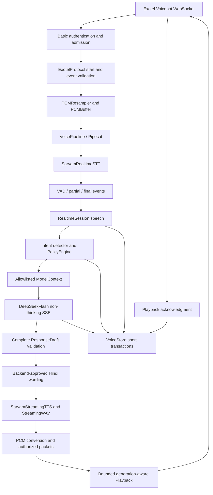

# Pratham AI: complete voice data flow

This document describes the current Slice 2 implementation. The production entry point is
`app.main.create_app()` and the call owner is `app.realtime.session.RealtimeSession`.
The original synchronous `ConversationOrchestrator` remains available for Slice 1 simulations,
golden evaluations, and single-turn replay. It is not the live call runtime.

See [the module/class guide](CODEBASE_GUIDE.md), [verification evidence](SLICE_2_VERIFICATION_REPORT.md),
and [the operator's real-phone procedure](LIVE_VOICE_TEST.md).

## Architecture and trust boundaries

Caller speech is untrusted input. The response model never receives the transcript, full business
record, arbitrary owner-rule instructions, prices, or inventory. It receives only an authorized
action and an optional confirmed closing-time phrase. The model returns a template choice and
a boolean, with extra fields forbidden. Only backend-rendered text reaches speech synthesis.

## 1. Exotel connects an incoming call

Exotel's bidirectional **Voicebot** applet opens `/voice/exotel`. The listen-only Stream applet
cannot play assistant responses. `main.create_app.lifespan()` owns the application settings,
database engine/session factory, telemetry, `SessionRegistry`, and per-call provider factory.

`realtime.router.exotel()` rejects disabled ingress or invalid Basic authentication before
accepting the socket. `api.security.valid_exotel_auth()` uses a separate ingress secret and
constant-time byte comparisons. Caller ID and custom parameters never authorize a call.

`SessionRegistry.reserve()` bounds accepted/in-progress sessions per process. Its lock protects
counter changes only; it is not held for the call lifetime. The pilot runs one application worker.
This is not distributed admission control.

## 2. Authenticate and initialize the session

The router accepts at most two handshake messages under `handshake_timeout_s`: an optional
`connected` followed by `start`, or `start` directly. `ExotelProtocol.parse()` validates metadata,
stream/call identifiers, event order, counters, and audio format. `StartInfo` retains normalized
metadata. The router then verifies the configured account SID and destination number and claims
the call SID with `SessionRegistry.claim()`. Only then does it construct fresh providers and
`RealtimeSession`.

### Reconciled media formats

The [Exotel protocol](https://developer.exotel.com/docs/agentstream/websocket-protocol) describes
`audio/x-raw` and `bit_rate=16`. The
[Voicebot applet example](https://developer.exotel.com/docs/agentstream/stream-voicebot-applet)
uses `raw` and `bit_rate=128` at 8 kHz. Both pages describe mono, signed 16-bit little-endian PCM.
`media_sample_rate()` interprets units only within their documented encoding spelling:

| Encoding | Meaning of `bit_rate` | 8 kHz | 16 kHz | 24 kHz |
| --- | --- | --- | --- | --- |
| `audio/x-raw` | Bits per sample | 16 | 16 | 16 |
| `raw` | PCM bitrate in kilobits/second | 128 | 256 | 384 |

The higher-rate `raw` values follow `sample_rate × 16 bits × 1 channel / 1000`; they are derived
from PCM arithmetic and the documented configurable rates, not from a captured live Exotel call.
Integer JSON values and decimal strings are accepted. Absent channel count means the documented
mono format; an explicit channel count must be one. Mixed unit/encoding pairs, compressed codecs,
unsupported rates, stereo, float/bool numeric metadata, and incomplete descriptions are rejected.
No fallback guesses a codec or treats a container as raw samples.

Protocol validation still rejects cross-stream media, replayed sequence numbers, decreasing
media timestamps, invalid base64/odd samples, wrong stop call IDs, duplicate starts, events after
stop, oversized messages, and incoming server-only events. Authentication/account/destination
validation remains outside the parser and precedes provider startup.

## 3. Audio enters Pipecat

`RealtimeSession.run()` first calls `VoiceStore.start()`, atomically recording the call, initial
business/rule snapshot, and `VoiceSession`. It starts `VoicePipeline`, connects STT, starts the
reader/playback/watchdog tasks, and schedules a reviewed AI-identifying greeting.

`RealtimeSession.receive()` obtains decoded media from `ExotelProtocol.parse()`. Its per-call
`PCMResampler` converts negotiated 8/16/24 kHz PCM into continuous 16 kHz PCM. Stateful soxr
conversion preserves filter history and timing across packets. `PCMBuffer(640)` produces fixed
20 ms, mono PCM16 frames regardless of incoming packet fragmentation.

`VoicePipeline.submit(IncomingPCM(...))` passes frames through an actual Pipecat
`PipelineWorker`/`WorkerRunner`. Three `VoiceProcessor` stages handle PCM, normalized speech
events, and authorized playback. Each frame has a completion future; its producer awaits
acknowledgment, which bounds outstanding work and carries processing errors/timeouts back to
the session. Lifecycle frames continue through Pipecat normally. The wrapper disables Pipecat
raw debug logging because frame representations can contain speech/audio.

## 4. Sarvam transcribes and controls turns

`RealtimeSession.audio()` sends internal PCM to `SarvamRealtimeSTT.audio()`.
`SarvamRealtimeSTT.start()` connects to the **realtime** endpoint, explicitly selects `saaras:v4`,
16 kHz `linear16`, Hindi, fast partials, and configured endpointing/VAD parameters, then requires
`session.begin`. A send lock serializes audio, boundary, ping, and end writes. A per-call
keepalive task is owned by the adapter.

With `VOICE_VAD_MODE=sarvam`, all frames, including silence, go to Sarvam. The local energy
detector is bypassed so two independent detectors cannot split the same utterance differently.
`SarvamRealtimeSTT.events()` maps `vad.speech_start/end` and `transcript.partial/final` into
`SpeechEvent`. `RealtimeSession.read_speech()` routes each through Pipecat to `speech()`:

- Speech start marks the caller active, resets idle recovery, and interrupts obsolete output.
- Speech end starts a bounded final-transcript wait without generating a response.
- Partial text updates bounded recovery state only. No partial invokes intent, policy, or model.
- A nonempty final clears partial state, deduplicates its utterance ID, persists the customer
  turn, and schedules a response. The same call can process multiple final turns.

Pauses remain provider-controlled. Silence sent during a server-active turn never causes local
endpointing. With `VOICE_VAD_MODE=energy`, the baseline RMS detector instead consumes exact
20 ms frames, retains 300 ms pre-roll, tolerates configured pauses, and sends manual boundaries
to Sarvam. It is an alternative mode, not a second detector running in parallel.

## 5. Intent and owner policy are authoritative

`RealtimeSession.respond()` loads fresh business facts/rules through `VoiceStore.context()` for
every final turn. `DeterministicIntentDetector.detect()` supports price enquiries and UNKNOWN.
`PolicyEngine.evaluate()` selects an enabled rule for the exact business/intent, sorting by
descending priority then stable rule ID. Unknown/missing policy requires owner attention.
Free-form rule instruction text is retained for auditing but is never executed by a model.

`VoiceStore.decision()` persists the action/rule/turn audit and expected policy outcome before
model generation. A safe price-policy result alone is insufficient to resolve the live call:
delivery must also be acknowledged and all turns complete.

## 6. Only authorized context reaches DeepSeek

`build_model_context()` constructs a new immutable, extra-forbidden `ModelContext`. It contains
`decision` and, only if authorized, `closing_time_phrase`. Constructing an allowlist avoids
accidental disclosure when business schemas later grow.

`DeepSeekFlash.generate()` sends JSON-mode SSE requests with `model=deepseek-flash` and
`thinking={"type":"disabled"}`. It sends a versioned fixed system prompt and only the serialized
context. No caller prompt or raw transcript enters its messages; no tools are offered.

## 7. Validate and render the response

The adapter buffers bounded SSE content, ignores reasoning fields, requires both a normal stop
finish and `[DONE]`, and validates the complete result as `ResponseDraft`. Its allowed fields
are `phrasing` (`POLITE`/`BRIEF`) and `mention_closing_time`. Arbitrary response text, prices,
extra fields, blank output, and truncated streams cannot pass this boundary.

The session revalidates the draft and uses `render_hindi()` in live mode or `render_response()`
in mock mode. The backend chooses reviewed text; confirmed closing time comes from context.
If model generation/validation fails, the session records safe diagnostics, marks attention,
and uses one deterministic authorized draft. This is an explicit safe response fallback, not
a fallback to fake provider success. Cancelled requests are recorded and re-raised, not rendered.

## 8. Sarvam synthesizes authorized text

The session persists an assistant message as `GENERATED` before synthesis.
`SarvamStreamingTTS.stream()` opens a fresh socket per utterance, explicitly selects
`bulbul:v4-flash`, voice/language, 16 kHz, and WAV output, then sends config, text, and flush.
Each generator owns its socket context, so cancellation closes the obsolete utterance rather
than contaminating a later response with old audio.

`StreamingWAV.feed()` incrementally validates RIFF/WAVE, PCM codec, mono channels, sample rate,
alignment, and 16-bit samples. It strips headers, handles fragmented/ancillary chunks and an
unknown-length streaming data sentinel, and retains a split sample byte. `finish()` rejects
truncated output. Header bytes never become playable samples. The session also validates every
returned PCM chunk and bounds individual provider stalls plus total response time.

## 9. Stream speech back through Exotel

An utterance-specific `PCMResampler` converts 16 kHz TTS back to the negotiated Exotel rate.
After flushing its filter tail, `PCMBuffer(3200)` pads only the final incomplete packet.
`AuthorizedPlayback` frames pass through Pipecat into `Playback.enqueue()`. The queue is bounded
and every `Packet` carries its generation; stale generations are dropped before enqueue/send.

`Playback.run()` serializes media/mark sends under a lock and paces audio outside the lock so
interruptions remain responsive. Output obeys 3200–100000 bytes, multiple of 320. At 8 kHz a
3200-byte PCM16 packet lasts 200 ms; at 16 kHz it lasts 100 ms. The byte contract is authoritative
where examples describe duration inconsistently.

A final message-ID packet registers a pending mark **before** sending it. A matching incoming
mark maps to the assistant message. `receive()` publishes PLAYED in memory before awaiting its
database write: a new STT speech-start may arrive on another task during that write. Unknown or
cleared marks cannot confirm delivery. `PLAYED` means Exotel acknowledgment, not a human
listening-test pass.

## 10. Persist call evidence and final outcome

`VoiceStore.execute()` serializes short operations under a per-call async lock and runs each
with a new SQLAlchemy Session inside `asyncio.to_thread`. No Session is shared across threads,
tasks, or calls. Shielding a transaction means cancellation waits for its write to finish before
releasing ordering; database failures roll back the operation.

Records include `Call`, `VoiceSession`, `VoiceTurn`, `ConversationMessage`, `PolicyDecision`,
`ModelInvocation`, `CallFailure`, and `CallOutcome`. Raw customer transcripts live in protected
application storage. Operational JSON logs/traces contain safe IDs, decisions, counts, hashes,
exception types, and stage timings, not transcripts, credentials, headers, or raw error bodies.

Delivery states distinguish `RECORDED` customer finals, `PARTIAL` recovery text, `GENERATED`
assistant text, acknowledged `PLAYED`, cancelled `INTERRUPTED`, and cleanup `UNCONFIRMED`.
`VoiceStore.finish()` atomically sets end reason/outcome/summary and closes unfinished states.
Any unresolved, interrupted, unconfirmed, or failed turn conservatively requires attention,
even if a later turn succeeded. A call with no query also requires attention.

## Interruptions, disconnects, failures, and cleanup

`RealtimeSession.interrupt()` increments generation before awaiting anything, cancels/joins
obsolete response work, clears playback under its send lock, and marks remaining unplayed text
INTERRUPTED. The generation check protects against late TTS/queued frames; cleared pending marks
protect against late carrier ACKs. An ACK received before clear retains PLAYED even if its
database commit is still pending. Already-playing carrier audio cannot be recalled.

`watchdog()` independently limits media loss, total call duration, utterance length, final wait,
provider stalls, and playback ACK time. True idle time gets one reviewed recovery prompt, then
close with attention. STT/TTS errors terminate the session; model errors use the authorized
fallback above. No automatic reconnect/retry replays caller speech or paid model requests.

On Exotel stop, disconnect, failure, or server cancellation, `run()` sets stopping, disables
playback, cancels/joins response and reader/watchdog tasks, closes every provider, and closes
Pipecat under finite deadlines. It records remaining partial text and sanitized failure/outcome
when call initialization succeeded, then closes the socket. Server CancelledError is propagated
after cleanup. The router releases admission and call claims in finally. If the database itself
fails, a safe persistence-failure event is emitted; durable recovery cannot be claimed. Abrupt
process death/stale-call reconciliation is outside this milestone.

## Verification boundaries

`AudioHarness` exercises this real PCM/session/store path with synthetic Exotel JSON and fake
providers. Contract tests separately exercise the real adapters against fake wire peers. The
Sarvam-VAD integration test combines its real event adapter with the full session and forces
model cancellation, playback clear/late ACK, pauses, partials, duplicate finals, and three turns.

`python -m app.live_provider_smoke --live` is a separate opt-in command for actual Sarvam and
DeepSeek requests. It synthesizes a fixed test sentence, checks the constrained model response,
and replays that speech at real-time speed through server VAD. Its report labels live attempts,
failures/blocked stages, and successful requests separately. It never calls Exotel or claims a
phone acceptance result. The [verification report](SLICE_2_VERIFICATION_REPORT.md) records the
single approved live execution and remaining carrier/listening checks.
